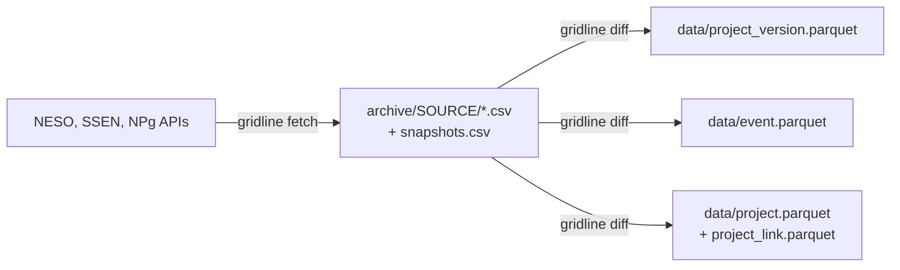

# Gridline

**A public history of Great Britain's grid connections queue, release by release.**

[](https://github.com/anwaroodin/gridline/actions/workflows/daily.yml)
[](LICENSE)
[](https://www.python.org/)
[](https://www.neso.energy/data-portal/neso-open-licence)

## Why this exists

New solar farms, wind farms and batteries in Great Britain can't be built until they have a grid
connection, and the queue for those connections is the main bottleneck. The National Energy System
Operator (NESO) publishes that queue as the Transmission Entry Capacity (TEC) register. The register
only shows the current state: each new release overwrites the last, and NESO keeps no past releases.
Smaller projects connect to the regional networks instead, and each Distribution Network Operator
(DNO) publishes its own Embedded Capacity Register (ECR), monthly, again overwriting the last.
In its September 2026 "Transforming Connections Data" consultation, Ofgem said stakeholders can't get
a complete and consistent picture of the queue. Gridline keeps the history.

## What it does today

- **Archives every release byte for byte**, named by its sha256, with a manifest of when it was
  fetched and published. Sources today:

  | Source | Register | Cadence |
  |---|---|---|
  | `tec` | NESO [TEC Register](https://www.neso.energy/data-portal/transmission-entry-capacity-tec-register) | about twice a week |
  | `embedded` | NESO [Embedded Register](https://www.neso.energy/data-portal/embedded-register): embedded projects in Scotland with a transmission agreement, in the TEC format (none of them are in TEC) | not stated |
  | `ssen` | SSEN Distribution [Embedded Capacity Register](https://data.ssen.co.uk/dataset/655eb750-7b3f-4c55-93b6-9bc4c26a57ab), 1 MW and above | monthly |
  | `npg` | Northern Powergrid [Embedded Capacity Register](https://northernpowergrid.opendatasoft.com/explore/dataset/embedded-capacity-register/), 1 MW and over | monthly |
  | `ukpn` | UK Power Networks Embedded Capacity Register, 1 MW and above | monthly, needs `UKPN_API_KEY` |
  | `spen` | SP Energy Networks Embedded Capacity Register, over 1 MW | monthly, needs `SPEN_API_KEY` |
  | `enwl` | SP Electricity North West Embedded Capacity Register, 1 MW and above | monthly, needs `ENWL_API_KEY` |

  The last three need a free account on each network's data portal. Put the API key in the named
  environment variable (a repository secret for the daily Action); without it the source is
  skipped with a notice. NGED is deferred: its register's licence doesn't clearly allow
  redistribution.
- **Turns the differences between releases into typed events**: a project added or withdrawn, a
  capacity change, a connection date that slipped, a status change, a gate assigned, a first
  connection.

Example output, from the test fixtures (real rows with hand edits, **not real changes**):

| event_type | project | old | new | days | low_confidence |
|---|---|---|---|---|---|
| `added` | BESS Harker (PRO-002010) | | | | yes |
| `added` | Example New Solar (no ID) | | | | yes |
| `withdrawn` | Artfield Forest Wind Farm (PRO-003578) | | | | |
| `status_changed` | Arbroath Battery Substation (PRO-000950) | Consents Approved | Built | | |
| `connected` | Arbroath Battery Substation (PRO-000950) | 0.0 | 35.0 | | |
| `date_slipped` | Aberarder Wind Farm (PRO-000368) | 2026-08-31 | 2026-11-30 | 91 | |
| `status_changed` | Blarghour Wind (PRO-000398) | Consents Approved | Built | | |
| `capacity_changed` | Al Boum Photo (Norton) (PRO-001651) | 275.0 | 300.0 | | |
| `status_changed` | Beaw Field Wind Farm (PRO-000026) | Consents Approved | Under Construction/Commissioning | | |
| `gate_assigned` | Barking BESS (PRO-003518) | | 2 | | |

## Who it's for

- **Developers** checking how their project and its neighbours move in the queue
- **Analysts and network planners** who need a consistent time series rather than a single snapshot
- **Journalists and researchers** asking how connections reform is playing out

## How it works



TEC rows are matched between releases on **Project ID + Stage**; ECR rows on the DNO's own row ID
(SSEN `Unique ID` without its status suffix, NPg `ecrid`). A row without a Project ID falls back to
its normalised name, connection site, plant type and stage. Rows that this key can't match
one-to-one (no Project ID, or a key repeated within one release) are kept and flagged
`low_confidence` instead of being hidden.

## Quick start

Requires [uv](https://docs.astral.sh/uv/).

```sh
git clone https://github.com/anwaroodin/gridline && cd gridline
uv sync
uv run gridline fetch   # archive each source's current release (skips ones already archived)
uv run gridline fetch ssen   # or just some sources
uv run gridline diff    # rebuild data/*.parquet from the whole archive
uv run gridline check   # exit non-zero if a source has had no new release for too long
uv run pytest
```

The package is named `gridline-uk` (`gridline` is taken on PyPI). It isn't published yet; once it
is, `pip install gridline-uk` installs the same `gridline` command.

Read the events with polars:

```python
import polars as pl

events = pl.read_parquet("data/event.parquet")
print(events.group_by("event_type").len())
print(
    events.filter(pl.col("event_type") == "date_slipped")
    .sort("days", descending=True)
    .head()
)
```

## Data model

| Output | One row per |
|---|---|
| `archive/<source>/snapshots.csv` (committed; also `data/source_snapshot.parquet`) | archived release: snapshot_id, source, fetched_at, published, sha256, raw_path, rows |
| `data/project_version.parquet` | version of a register row, valid from `valid_from` until `valid_to` (empty = current) |
| `data/event.parquet` | change between two consecutive releases |
| `data/project.parquet` | project, under a Gridline ID (`GL-` + 8 characters) that never changes: name, technology, MW, status, gate and date from its TEC row if it has one, else its newest register row |
| `data/project_link.parquet` | register row (`register` + `key`) and the project it belongs to, with `method` (`id`: its own row or a shared official ID; `rule`, `jev` or `override`: matched to a TEC project), `confidence` (Jev's P(same)) and `evidence` |
| `data/possible_match.parquet` | a TEC project and an ECR row that may be the same project but aren't linked, with Jev's `probability` (empty when Jev wasn't asked) and the evidence |
| `archive/project_ids.csv` (committed) | the ID ledger: every register row ever seen and the ID it was given, so rebuilds keep IDs. Two projects that merge keep the older ID; the other is kept as `merged_into` |

Every output is also written as CSV beside the Parquet file (`data/event.csv`, ...).

Columns of the project tables:

| Table | Column | Meaning |
|---|---|---|
| `project` | `project_id` | Gridline ID, `GL-` + 8 characters |
| | `name`, `plant_type`, `mw_total`, `status`, `gate`, `effective_from` | from the project's TEC or Embedded Register row if it has one, else its newest DNO row |
| | `gsp_id` | GSP ID from `reference/gsp.csv`, or the cleaned site name |
| | `registers`, `source_ids` | the registers it appears in, and their own IDs as `register:ID`; both `;`-separated |
| | `members` | how many register rows belong to it |
| | `first_seen` | publication date of the first release any of its rows appears in |
| | `live` | one of its rows is in its register's newest release |
| `project_link` | `project_id`, `register`, `key`, `source_id` | which project a register row belongs to |
| | `method` | `id` (the row itself, or a shared official ID), `rule`, `jev` or `override` |
| | `confidence` | Jev's P(same project) for a matched row; empty for `id`, and for `rule` when Jev wasn't asked |
| | `evidence` | rule points and the facts behind them, Jev's answer, or the override's reason |
| `possible_match` | `project_id` | the TEC or Embedded Register row's project |
| | `register`, `key`, `other_project_id` | the DNO row and the project it is in now |
| | `probability` | Jev's P(same project); empty when Jev wasn't asked |
| | `evidence` | as in `project_link` |

| Event | Meaning |
|---|---|
| `added` | the row appears for the first time |
| `withdrawn` | the row is no longer in the TEC register |
| `stage_split` | a TEC Project ID that had one Stage now has several: it stays one project. `old_value` is the old key, `new_value` the new stage keys (`;`-separated), instead of `withdrawn` + `added` |
| `renamed` | a DNO register row continues under another name (same export meter number, a near-identical name at the same GSP, or a placeholder name such as "49.9MW BATTERY" replaced by the site name). `old_value` and `new_value` are the names. Always `low_confidence` |
| `removed_from_register` | the row is no longer in a DNO register. Not called withdrawn: under connections reform some projects moved to Gate 1 and were removed from ECRs |
| `capacity_changed` | TEC: Cumulative Total Capacity (MW) changed. ECR: the registered capacity (accepted-to-connect, or already-connected once connected) changed |
| `date_slipped` | TEC: MW Effective From moved. ECR: Target Energisation Date moved (NPg leaves it blank, so none there). `days` is positive when later, negative when brought forward |
| `status_changed` | TEC: Project Status changed (for example Scoping → Consents Approved). ECR: accepted to connect → connected |
| `gate_assigned` | the Gate column was set or changed (Gate 1 / Gate 2 under connections reform) |
| `connected` | MW Connected (ECR: already-connected capacity) rose above 0 for the first time |

Every event and version carries `project_id` (the Gridline ID), `register` (`tec`, `embedded`, `ssen`, `npg`), `key`, `source_id` (the register's own ID, such as a TEC Project ID or SSEN Unique ID) and `low_confidence`; events also carry `project_number`, `old_value` and `new_value`.

## How projects are matched

A TEC row for an embedded project and the DNO register row for the same site never share an ID,
and are often named differently (*Clayfords Energy Storage* in TEC, *CLAYFORDS ENERGY STORAGE* in
SSEN's register; *Fettereso BESS* and *THE WATERS BESS*). `gridline diff` links them so one
project has one Gridline ID across registers. Every step runs on each rebuild:

1. **Which rows.** TEC rows with Agreement Type "Embedded", and every row of NESO's Embedded
   Register, whose transmission owner is SHET (matched to SSEN) or NGET (SSEN and NPg). The
   other ECRs are matched once their sources are archived.
2. **Blocking.** A pair is scored only if both rows are in the same network area (SSEN north or
   south), have a compatible technology (an ECR row marked "other" or blank fits any), and share
   a GSP or a name word of 4 or more letters.
3. **Rules.** Points for name similarity (up to 4), the same GSP (1.5), capacity within 10% (1.5)
   or 25% (0.7) and the same company (1). A different phase number (*Farm 2* and *Farm 3*) takes
   3 off. 6 or more is a rule link, 4 to 6 is unsure.
4. **Jev.** Unsure pairs, and rule links, go to TypeSafe's Jev model (`jev-1.14.0`), which
   returns how likely the two rows are the same project, a related one (another phase, an
   extension) or a different one. Only register fields are sent: names, sites, technology,
   MW, status, dates, the network, and the customer only when it looks like a company. No IDs
   and no person's name. A rule link stays a link at P(same) 0.5 or more; an unsure pair
   becomes a link at 0.9 or more and is dropped under 0.3. Anything in between is a **possible
   match**, published with its probability rather than linked.
5. **Guard.** A connected ECR row is never linked to a TEC project that hasn't started building
   (not Built or Under Construction, no connected MW): the TEC row is usually a new phase. The
   pair becomes a possible match instead.
6. **Assignment.** Each ECR row links to at most one TEC project, its best pair (P(same) plus
   rule points out of 8). A TEC project may link to several ECR rows, such as a hybrid site's
   wind and battery rows.
7. **Sticky IDs.** A row keeps the Gridline ID it had on the last rebuild
   ([`archive/project_ids.csv`](archive/project_ids.csv)). When two projects are linked, the
   older ID wins.

Jev's answers are kept in [`reference/jev_answers.csv`](reference/jev_answers.csv), keyed by the
sha256 of the exact request, so each pair is asked once and a rebuild needs no key and no network.
Set `TYPESAFE_API_KEY` (in `.env` or the environment; a repository secret for the daily Action)
to ask about new pairs. Without it, new pairs are decided by the rules alone and their evidence
says so.

### Corrections

`reference/overrides.csv` beats the rules and Jev. Columns `action,a,b,why`, where `action` is
`link` or `separate` and `a`, `b` name rows as `register:key` or `register:source_id`:

```csv
action,a,b,why
separate,tec:<TEC Project ID>,ssen:<SSEN Unique ID>,a later phase of the built farm
link,tec:<TEC Project ID>,npg:<ecrid>,same developer and site under another name
```

A `link` replaces whatever the matcher linked that ECR row to; `separate` also undoes a link
kept from an earlier build. A row that no longer exists stops the build, so a stale correction
is never silently dropped.

### How good it is

[`reference/labels.csv`](reference/labels.csv) holds about 470 pairs labelled by hand with the
evidence. A test rebuilds every decision from it and fails if, among pairs not marked unsure:

| Measure | Bar | Now |
|---|---|---|
| Links that are the same project | 97% | 98.6% of 142 |
| True pairs linked or listed as possible | 90% | 98.4% of 189 |
| Pairs found by hand that blocking scores at all | 85% | 5 of 5 |

The labels are one person's judgement from public fields. A possible match is a lead to check,
not a fact.

## Data and archive

- Raw releases live in [`archive/<source>/`](archive/), committed to this repository. The registers
  overwrite themselves, so this archive is the history.
- **Older ECR history lives in a GitHub Release**, not in git: SSEN's monthly workbooks from August
  2023 and NPg's from January 2022 (release
  [`history-ecr-2022-2026`](https://github.com/anwaroodin/gridline/releases/tag/history-ecr-2022-2026)).
  Their manifest rows are committed and point at the Release asset; `gridline diff` downloads each
  file once into `data/cache/` and refuses it if its sha256 differs from the manifest. Most
  workbooks have no row ID, so a history row takes the ID of the row with the same site, GSP and
  technology in the current CSVs where exactly one matches, or the one with the same capacity
  when a site name repeats (`low_confidence`); the rest are matched by name. NPg workbooks from
  May 2026 carry the ID as "Unique Site Identifier".
- A row without an ID that leaves a release while another arrives is checked before calling it
  removed: the same export meter number (MPAN), else the same GSP and a name at least 85% alike
  with the same numbers in it (so *Farm 2* is never *Farm 3*), else the only row each side with
  the same GSP, technology, capacity, date and status. A match continues the old row, with a
  `renamed` event if the name changed. Two rows that both carry their own ID are never joined.
- **TEC projects are matched to ECR rows** automatically; see
  [How projects are matched](#how-projects-are-matched).
- GSP names are compared by GSP ID from [`reference/gsp.csv`](reference/gsp.csv): NESO's GSP
  lookup plus aliases for other spellings, so a register that renames its GSPs (SSEN switched from
  codes such as `MELK` to names such as `MELKSHAM GSP` in October 2023) keeps its rows' keys.
- `.gitattributes` marks the archive `-text`, so git never rewrites line endings. A changed byte
  would change the file's sha256.
- A [daily GitHub Action](.github/workflows/daily.yml) runs `fetch` and `diff` and commits any new
  release to `main`, one commit per source. One failing source doesn't stop the others; the run
  still fails afterwards so someone notices.
- A release is refused, and nothing is written, if it has no data rows (a login-gated portal returns
  just the header), under half the rows of the latest release (a cut-off download), or no IDs when
  the latest release had them (a renamed ID column). If the drop is real, `gridline fetch --force
  SOURCE` archives it anyway.
- **History starts on 19 November 2026** for TEC, because NESO publishes no earlier files, in
  August 2023 for SSEN and in January 2022 for NPg.
- If you hold older TEC register CSVs, `gridline backfill` loads them. The release date must be in the
  file name, for example `tec-register-28-february-2025.csv`:

  ```sh
  uv run gridline backfill path/to/tec-register-28-february-2025.csv
  ```

  Contributions of past releases are very welcome. Please open an issue.

## Roadmap

- [x] Phase 0: TEC register archive and events
- [ ] Phase 1: the six DNO Embedded Capacity Registers (SSEN and NPg with history; UKPN, SPEN and
  ENWL waiting for API keys; NGED deferred until its licence allows redistribution)
- [x] Cross-register project matching: TEC and NESO's Embedded Register to SSEN and NPg
- [ ] Planned: match the other ECRs once archived, and REPD
- [ ] Planned: REST API
- [ ] Planned: web app with map, project history and reform view
- [ ] Planned: delivery-risk model

## Contributing

- Use [Conventional Commits](https://www.conventionalcommits.org/) (`feat:`, `fix:`, `docs:`, ...).
- Before opening a pull request, run `uv run pytest`, `uvx ruff format` and `uvx ruff check`.
- For larger changes, open an issue first so we can agree on the approach.

## Licence and attribution

Code: [Apache-2.0](LICENSE).

Data, by source:

- **NESO (`tec`, `embedded`):** Contains data from the National Energy System Operator (NESO),
  published under the [NESO Open Data Licence](https://www.neso.energy/data-portal/neso-open-licence).
  Source: [TEC Register](https://www.neso.energy/data-portal/transmission-entry-capacity-tec-register),
  [Embedded Register](https://www.neso.energy/data-portal/embedded-register) and the GSP lookup in
  `reference/gsp.csv`
  ([GIS Boundaries for GB Grid Supply Points](https://www.neso.energy/data-portal/gis-boundaries-gb-grid-supply-points)).
- **SSEN (`ssen`):** Contains data from SSEN Distribution, licensed under
  [CC BY 4.0](https://creativecommons.org/licenses/by/4.0/). Source:
  [Embedded Capacity Register](https://data.ssen.co.uk/dataset/655eb750-7b3f-4c55-93b6-9bc4c26a57ab).
  The raw files in `archive/ssen/` are unchanged; the derived data in `data/` was changed by
  Gridline (columns renamed and reduced, values normalised, events computed between releases).
- **Northern Powergrid (`npg`):** Supported by Northern Powergrid Open Data, under the
  [Northern Powergrid Open Data Licence](https://northernpowergrid.opendatasoft.com/p/opendatalicence/).
  Source: [Embedded Capacity Register](https://northernpowergrid.opendatasoft.com/explore/dataset/embedded-capacity-register/).
  Its export includes derived location fields: Contains OS data © Crown copyright and database
  right. Office for National Statistics licensed under the Open Government Licence v.3.0.
- **Matching:** `probability`, `confidence` and the `jev` method come from TypeSafe's Jev model
  (`jev-1.14.0`), a model's judgement from the register fields above, not data from any
  register. The hand labels in `reference/labels.csv` are Gridline's.
