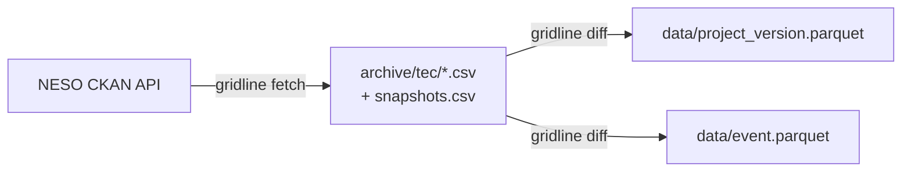

# Gridline

**A public history of Great Britain's grid connections queue, release by release.**

[](https://github.com/anwaroodin/gridline/actions/workflows/daily.yml)
[](LICENSE)
[](https://www.python.org/)
[](https://www.neso.energy/data-portal/neso-open-licence)

## Why this exists

New solar farms, wind farms and batteries in Great Britain can't be built until they have a grid
connection, and the queue for those connections is the main bottleneck. The National Energy System
Operator (NESO) publishes that queue as the Transmission Entry Capacity (TEC) register. The register
only shows the current state: each new release overwrites the last, and NESO keeps no past releases.
In its September 2026 "Transforming Connections Data" consultation, Ofgem said stakeholders can't get
a complete and consistent picture of the queue. Gridline keeps the history.

## What it does today

- **Archives every TEC register release byte for byte**, named by its sha256, with a manifest of when
  it was fetched and published.
- **Turns the differences between releases into typed events**: a project added or withdrawn, a
  capacity change, a connection date that slipped, a status change, a gate assigned, a first
  connection.

Example output, from the test fixtures (real rows with hand edits, **not real changes**):

| event_type | project | old | new | days | low_confidence |
|---|---|---|---|---|---|
| `added` | BESS Harker (PRO-002010) | | | | yes |
| `added` | Example New Solar (no ID) | | | | yes |
| `withdrawn` | Artfield Forest Wind Farm (PRO-003578) | | | | |
| `status_changed` | Arbroath Battery Substation (PRO-000950) | Consents Approved | Built | | |
| `connected` | Arbroath Battery Substation (PRO-000950) | 0.0 | 35.0 | | |
| `date_slipped` | Aberarder Wind Farm (PRO-000368) | 2026-08-31 | 2026-11-30 | 91 | |
| `status_changed` | Blarghour Wind (PRO-000398) | Consents Approved | Built | | |
| `capacity_changed` | Al Boum Photo (Norton) (PRO-001651) | 275.0 | 300.0 | | |
| `status_changed` | Beaw Field Wind Farm (PRO-000026) | Consents Approved | Under Construction/Commissioning | | |
| `gate_assigned` | Barking BESS (PRO-003518) | | 2 | | |

## Who it's for

- **Developers** checking how their project and its neighbours move in the queue
- **Analysts and network planners** who need a consistent time series rather than a single snapshot
- **Journalists and researchers** asking how connections reform is playing out

## How it works



Rows are matched between releases on **Project ID + Stage**. A row without a Project ID falls back to
its normalised name, connection site, plant type and stage. Rows that this key can't match
one-to-one (no Project ID, or a key repeated within one release) are kept and flagged
`low_confidence` instead of being hidden.

## Quick start

Requires [uv](https://docs.astral.sh/uv/).

```sh
git clone https://github.com/anwaroodin/gridline && cd gridline
uv sync
uv run gridline fetch   # archive the current release (skips one already archived)
uv run gridline diff    # rebuild data/*.parquet from the whole archive
uv run pytest
```

Read the events with polars:

```python
import polars as pl

events = pl.read_parquet("data/event.parquet")
print(events.group_by("event_type").len())
print(
    events.filter(pl.col("event_type") == "date_slipped")
    .sort("days", descending=True)
    .head()
)
```

## Data model

| Output | One row per |
|---|---|
| `archive/tec/snapshots.csv` (committed; also `data/source_snapshot.parquet`) | archived release: snapshot_id, source, fetched_at, published, sha256, raw_path, rows |
| `data/project_version.parquet` | version of a register row, valid from `valid_from` until `valid_to` (empty = current) |
| `data/event.parquet` | change between two consecutive releases |

| Event | Meaning |
|---|---|
| `added` | the row appears for the first time |
| `withdrawn` | the row is no longer in the register |
| `capacity_changed` | Cumulative Total Capacity (MW) changed |
| `date_slipped` | MW Effective From moved; `days` is positive when later, negative when brought forward |
| `status_changed` | Project Status changed (for example Scoping → Consents Approved) |
| `gate_assigned` | the Gate column was set or changed (Gate 1 / Gate 2 under connections reform) |
| `connected` | MW Connected rose above 0 for the first time |

Every event carries `low_confidence`, `project_id`, `project_number`, `old_value` and `new_value`.

## Data and archive

- Raw releases live in [`archive/tec/`](archive/tec/), committed to this repository. NESO keeps no past
  releases, so this archive is the history.
- `.gitattributes` marks the archive `-text`, so git never rewrites line endings. A changed byte
  would change the file's sha256.
- A [daily GitHub Action](.github/workflows/daily.yml) runs `fetch` and `diff` and commits any new
  release to `main`.
- **History starts on 19 November 2026**, because NESO publishes no earlier files.
- If you hold older TEC register CSVs, `gridline backfill` loads them. The release date must be in the
  file name, for example `tec-register-28-february-2025.csv`:

  ```sh
  uv run gridline backfill path/to/tec-register-28-february-2025.csv
  ```

  Contributions of past releases are very welcome. Please open an issue.

## Roadmap

- [x] Phase 0: TEC register archive and events
- [ ] Planned: the six DNO Embedded Capacity Registers
- [ ] Planned: cross-register project matching
- [ ] Planned: REST API
- [ ] Planned: web app with map, project history and reform view
- [ ] Planned: delivery-risk model

## Contributing

- Use [Conventional Commits](https://www.conventionalcommits.org/) (`feat:`, `fix:`, `docs:`, ...).
- Before opening a pull request, run `uv run pytest`, `uvx ruff format` and `uvx ruff check`.
- For larger changes, open an issue first so we can agree on the approach.

## Licence and attribution

Code: [Apache-2.0](LICENSE).

Data: Contains data from the National Energy System Operator (NESO), published under the
[NESO Open Data Licence](https://www.neso.energy/data-portal/neso-open-licence). Source:
[TEC Register](https://www.neso.energy/data-portal/transmission-entry-capacity-tec-register).
